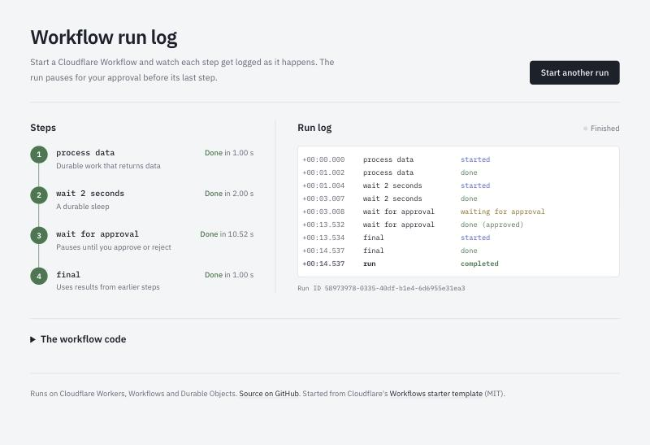

# logging-workflow

[](https://github.com/patrickking67/logging-workflow/actions/workflows/ci.yml)
[](LICENSE)

A small Cloudflare Workers app that starts a Workflow run and logs every step live in the browser, streamed over a WebSocket from a Durable Object.

There is no public deployment. Run it locally with the steps below.



## Credit

This repo started from Cloudflare's [Workflows Starter Template](https://github.com/cloudflare/templates/tree/main/workflows-starter-template) (MIT, Copyright (c) 2018 Cloudflare, Inc.). The overall shape (a Worker, a four step Workflow, a Durable Object pushing status over a WebSocket, and a React front end) comes from that template. See [LICENSE](LICENSE) and [CHANGELOG.md](CHANGELOG.md) for what changed here.

## Features

- Start a run and follow four steps: durable work (`step.do`), a durable sleep (`step.sleep`), a pause for approval (`step.waitForEvent`), and a final step that uses earlier results.
- A timestamped run log, kept by the Durable Object and capped at 100 lines, shown with the offset from the start of the run.
- Approve or reject the paused run from the page. The decision is logged and returned as the run's output.
- Failed runs (for example an approval that times out) are logged and shown, not left spinning.
- The page reconnects if the WebSocket drops mid-run, and works in light and dark mode and on small screens.

## Quickstart

Needs Node.js 20.19 or later (Vite 7). No Cloudflare account or login is needed to run locally.

```bash
npm ci
npm run dev
```

Open http://localhost:4109 and select **Start a run**. Vite runs the Worker, Workflow and Durable Object locally through the Cloudflare Vite plugin.

## Architecture

```text
Browser (React, src/)
  | POST /api/workflow/start          -> Worker creates a MyWorkflow instance
  | GET  /ws?instanceId=...           -> Worker forwards to WorkflowStatusDO for that ID
  | POST /api/workflow/event/:id      -> Worker sends a user-approval event to the run
  v
Worker (worker/index.ts)  validates input, routes requests, serves dist/ as a SPA
  |
  +-- MyWorkflow (worker/workflow.ts)
  |     process data -> wait 2 seconds -> wait for approval -> final
  |     reports each step change and any failure to the Durable Object over RPC
  |
  +-- WorkflowStatusDO (worker/durable-object.ts), one per run
        keeps step statuses and the run log in storage (rules in worker/status.ts)
        pushes the full state to every connected WebSocket on each change
```

- **Worker** (`worker/index.ts`): routes `POST /api/workflow/start`, `GET /api/workflow/status/:id`, `POST /api/workflow/event/:id` and `GET /ws`. Instance IDs and approval bodies are validated before they reach a binding.
- **Workflow** (`worker/workflow.ts`): the four steps. Status reports run outside `step.do`, so they can replay after a restart; the Durable Object ignores reports that change nothing. On failure the run reports the error and rethrows so the instance still ends as errored.
- **Durable Object** (`worker/durable-object.ts`): one object per run, named by instance ID. Uses the WebSocket Hibernation API so it can sleep while browsers stay connected.
- **Run state** (`worker/status.ts`): pure functions for step transitions, the log and errors, shared with the front end for types and step names.
- **Front end** (`src/`): React 19, Vite and Tailwind. `src/hooks/useWorkflowWebSocket.ts` holds the socket; `src/components/` has the step list, run log and code view.

## Tests

```bash
npm run check
```

That runs lint (no warnings allowed), type checks, the Vitest suite inside the Workers runtime, the production build, and `wrangler deploy --dry-run` to confirm the Worker bundles. CI runs the same command.

The tests cover the run state rules (`test/status.test.ts`), the Durable Object over RPC and WebSocket (`test/durable-object.test.ts`), the Workflow's approve, reject and timeout paths (`test/workflow.test.ts`), and the HTTP routes and validation (`test/api.test.ts`).

## Deploy

Not deployed. `npm run deploy` builds and publishes the Worker to whichever Cloudflare account Wrangler is logged in to, on its workers.dev subdomain. Only the owner runs it. Nothing in CI deploys.

The routes have no authentication: anyone who knows a run ID can watch or approve that run. Read [SECURITY.md](SECURITY.md) before putting it on the internet.

## License

MIT. See [LICENSE](LICENSE), which keeps Cloudflare's original copyright for the template code.
